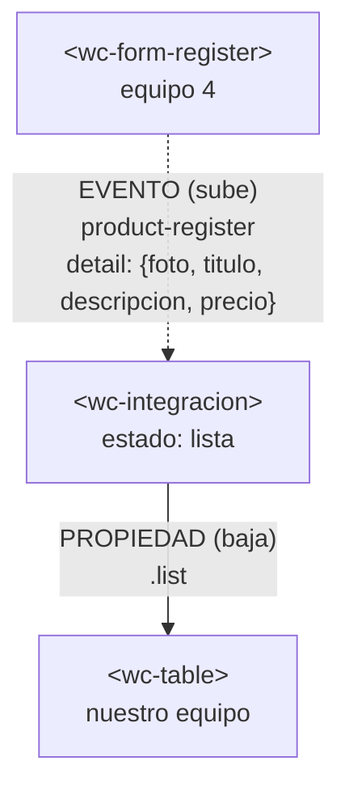

# Integración con el componente de otro equipo

## 1. Datos

| Campo | Valor |
|---|---|
| Equipo | Equipo 3 · Café Raíz · [repositorio](https://github.com/Shairr/Componentes-Lit-G3) |
| Equipo externo | Equipo 4 |
| Repositorio externo | https://github.com/MezaJose12/Taller-Pic.git |
| Archivo externo | `register.js` (`<wc-form-register>`) → copiado en `src/externos/equipo-4/register.js` |
| Commit usado | 4d77039 |

## 2. Componentes y roles

| Componente | Archivo | Origen | Rol |
|---|---|---|---|
| `<wc-integracion>` | `src/views/integracion/integracion.js` | Nuestro equipo | **Padre**. Dueño del estado `lista`; escucha el evento del formulario y le pasa los datos a la tabla. |
| `<wc-form-register>` | `src/externos/equipo-4/register.js` | Equipo 4 | **Hijo que emite**. Lanza el evento `product-register` al enviar el formulario. |
| `<wc-table>` | `src/views/home/table.js` | Nuestro equipo | **Hijo que recibe**. Recibe la lista por la propiedad `list`. |

## 3. Flujo de comunicación



**Adaptador.** El formulario del equipo 4 manda en el `detail` un objeto con `foto`, `titulo`, `descripcion` y `precio`. Nuestra tabla espera `nombre`, `origen`, `precio`, `cantidad` y `total`, así que no se podían conectar directamente. Como no podíamos tocar el componente del otro equipo, hicimos la conversión en el padre:

- `titulo` pasa a ser `nombre` y `descripcion` pasa a ser `origen`.
- El precio se vuelve a convertir con `Number(...) || 0` por si llega vacío.
- Su formulario no tiene cantidad, así que ponemos `cantidad = 1` y calculamos `total = precio * cantidad`.
- Al final creamos un arreglo nuevo con `[...this.lista, fila]`, porque con `push` Lit no actualiza la tabla.

```js
agregarProducto(event) {
  const producto = event.detail;

  const precio = Number(producto.precio) || 0;
  const cantidad = 1;

  const fila = {
    nombre: producto.titulo,
    origen: producto.descripcion,
    precio: precio,
    cantidad: cantidad,
    total: precio * cantidad,
  };

  this.lista = [...this.lista, fila];
}
```

## 4. Dificultades

| # | Integrante | Síntoma | Causa | Solución |
|---|---|---|---|---|
| 1 | Fernando Camaton | Al registrar un producto la fila salía con celdas vacías o con `NaN`. | El formulario del equipo 4 y nuestra tabla usan campos distintos (`titulo`/`descripcion` contra `nombre`/`origen`) y el formulario no trae cantidad ni total. | Escribir el adaptador en el padre, sin tocar el archivo del otro equipo. |
| 2 | Denilson Celi | Riesgo de error en consola con `customElements.define` por registrar dos veces `wc-form-register`. | Los dos equipos usamos la misma etiqueta y nuestro `home.js` y `src/index.js` cargan la nuestra. | En `integracion.js` importamos solo `register.js` del equipo 4 y nuestro `table.js`; `integracion.html` no carga la navegación. |
| 3 | Farid Hinojoza | Al probar casos límite para la evaluación, el formulario permitía enviar precios como `NaN` o la URL de foto vacía sin validar. | En `register.js` (línea 43) convierten con `Number(...)` directo sin verificar `isNaN`, y en su repo no documentaban el formato esperado de los datos. | Se aislaron los pasos para reproducir el fallo con archivo y línea exactos, y se redactó el issue con la propuesta de mejora técnica en su repositorio. |
| 4 | Andrés Pozo | No estaba claro qué datos traía el `detail` del evento. | El componente del otro equipo no tiene comentarios ni documentación del evento. | Leímos su código (`register.js`, líneas 39-52) y dejamos los campos explicados en el adaptador. |

## 5. Evaluación del componente externo

| Aspecto | Nota (0–5) | Evidencia |
|---|---|---|
| API clara | 4 | Los nombres de la etiqueta y del evento (`product-register`, línea 47) se entienden, pero no dice qué trae el `detail`; hubo que leer el objeto `producto` de las líneas 39-44. |
| Evento bien construido | 5 | En las líneas 46-52 usa `CustomEvent` con los datos en `detail`, `bubbles: true` y `composed: true`; llega al padre sin problema. |
| Robustez | 3 | Confía en las validaciones del navegador (`required`, `min`, líneas 67-75). Si el precio queda vacío, `Number("")` da 0 (línea 43) y el evento se envía igual; la foto vacía viaja como texto vacío (línea 40). |
| Encapsulamiento | 5 | Sus estilos están dentro de `static styles` (líneas 4-32); no afectaron a nuestra página ni la nuestra a él. |
| Reutilización | 4 | Lo usamos sin cambiar una línea y solo depende de `lit`. Le falta poder configurar cosas como los textos. |

Issue abierto: https://github.com/MezaJose12/Taller-Pic/issues/2#issue-6175522937

## 6. Uso de IA

Los cuatro integrantes usamos IA, pero solo para cosas pequeñas: resolver dudas puntuales, entender algún error y revisar un texto o un fragmento de código. La integración, la evaluación del componente externo y el issue los hicimos nosotros, y lo que sugería la IA lo revisamos y lo adaptamos antes de usarlo.

| Herramienta | Quién la usó | Para qué | Qué cambiamos |
|---|---|---|---|
| Antigravity y Gemini | Denilson Celi | Dudas pequeñas sobre cómo copiar el componente externo y escribir los imports. | Ajustó lo sugerido a las rutas y nombres reales del proyecto. |
| Antigravity y Gemini | Fernando Camaton | Dudas pequeñas sobre el adaptador del `detail` y la página `integracion.html`. | Lo adaptó a los campos reales de la tabla y probó el resultado en el navegador. |
| Antigravity y Gemini | Farid Hinojoza | Dudas pequeñas para ordenar la evaluación del componente externo. | Escribió las notas y el issue con lo que vio en el código. |
| Antigravity y Gemini | Andrés Pozo | Ayuda para ordenar esta documentación y el diagrama Mermaid. | Corregí nombres de evento y propiedades con el código real y reescribí los textos. |

## 7. Aportes del equipo

Cada integrante hace commits con su propia cuenta de GitHub. Quien no tenga commits propios en el pull request se califica aparte.

| Integrante | Usuario de GitHub | Rol | Qué hizo | Enlace a sus commits |
|---|---|---|---|---|
| Celi Denilson | [@Shairr](https://github.com/Shairr) | 1 · Integración | Rama `taller-integracion`, copia del componente del equipo 4, padre `<wc-integracion>` y pull request. | [b365670](https://github.com/Shairr/Componentes-Lit-G3/commit/b365670) · [todos](https://github.com/Shairr/Componentes-Lit-G3/commits?author=Shairr) |
| Camaton Fernando | [@Rarexz08](https://github.com/Rarexz08) | 2 · Adaptador y pruebas | Adaptador del `detail`, `integracion.html`, pruebas con lista vacía y datos de texto, y captura. | [71232c2](https://github.com/Shairr/Componentes-Lit-G3/commit/71232c2) |
| Hinojoza Farid | [@FaridHinojoza](https://github.com/FaridHinojoza) | 3 · Revisión externa | Tabla de evaluación del componente externo e issue en el repositorio del otro equipo. |  |
| Pozo Andrés | [@andrespozo237-coder](https://github.com/andrespozo237-coder) | 4 · Documentación | Este documento, el diagrama Mermaid, y la revisión y fusión del pull request. | [7ed9e9e](https://github.com/Shairr/Componentes-Lit-G3/commit/7ed9e9e) · [todos](https://github.com/Shairr/Componentes-Lit-G3/commits?author=andrespozo237-coder) |

Pull request: [#1](https://github.com/Shairr/Componentes-Lit-G3/pull/1) · Revisado por: Pozo Andrés
